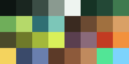

# Kit de estilo

O kit versionado que deixa a geração de arte por IA reproduzível entre as duas pessoas da equipe ([ADR 0004](../docs/adr/0004-arte-pixel-gameplay-ilustracao-telas.md), [ADR 0005](../docs/adr/0005-povo-ficticio-diretriz-de-representacao.md)).

| Arquivo | Para quê |
|---|---|
| [`paleta.hex`](paleta.hex) | **Fonte única** da paleta: 32 cores com nome, grupo e uso |
| [`paleta.png`](paleta.png) | A paleta como imagem (anexar nos prompts; gerada a partir do `.hex`) |
| [`paleta.gpl`](paleta.gpl) | A paleta para importar no Aseprite, GIMP, Krita ou Pixelorama (gerada) |
| [`estilo-gameplay.md`](estilo-gameplay.md) | Regras e prompt-base da pixel art 16×16 (PixelLab) |
| [`estilo-ilustracao.md`](estilo-ilustracao.md) | Prompt-base da ilustração pintada, ferramenta de cada série e âncoras |
| [`representacao.md`](representacao.md) | Diretriz "fazer / evitar" para todo prompt de arte, texto e música |
| [`prompts/`](prompts/README.md) | Convenção e modelo para guardar o prompt exato de cada asset |
| [`ancoras/`](ancoras/README.md) | Imagens-âncora aprovadas no teste de estilo (#21) |

## Paleta



Ao mudar uma cor, edite **só** `paleta.hex` e rode:

```bash
npm run gerar-paleta
```

Isso atualiza `paleta.png` e `paleta.gpl`. O teste `src/core/paleta.test.ts` confere que a paleta tem de 24 a 32 cores válidas, sem repetição, e com os grupos de floresta viva, floresta contaminada e empresa.

| Grupo | Cores |
|---|---|
| Neutros | noite `#0d1512` · sombra da mata `#1a2620` · pedra `#3b4d45` · névoa `#8a9a90` · luz `#eef4f0` |
| Floresta viva | verde profundo `#163325` · verde copa `#234836` · verde folha `#3f7a4f` · broto `#6fae5a` · verde claro `#b5d96a` · água limpa `#2f6f73` · reflexo `#7cc6b8` |
| Terra e madeira | terra escura `#3a2a20` · madeira `#6b4a32` · barro `#a0703f` · areia `#d9a066` |
| Floresta contaminada | lodo `#4a4a2a` · verde doente `#6f7a2a` · gosma `#a3b83a` · gosma acesa `#d9f05a` · óleo `#5a3f4f` · fumaça `#8a6a7a` |
| Empresa | vermelho máquina `#c23b22` · laranja alerta `#f2913d` · amarelo sinal `#f4d35e` · azul uniforme `#3a4a6a` · metal `#6a7fae` |
| Pessoas | pele escura `#5c3a28` · pele média `#8d5a3b` · pele clara `#c08a5e` |
| Luzes | espírito `#52e596` · Totem `#7dd3fc` |

## Fluxo para gerar um asset

1. Leia o guia da camada (gameplay ou ilustração) e, se houver pessoas, a [diretriz de representação](representacao.md).
2. Monte o prompt: prompt-base + trecho de representação (se houver pessoas) + pedido do asset. Anexe `paleta.png` e a âncora da série.
3. Gere na ferramenta definida para a série.
4. Confira o checklist do guia.
5. Salve o prompt exato em `art/prompts/` (copie o [modelo](prompts/_modelo.md)).
6. Personagens: peça a revisão de representação e registre no arquivo do prompt.
7. Coloque o arquivo final em `public/assets/`.
